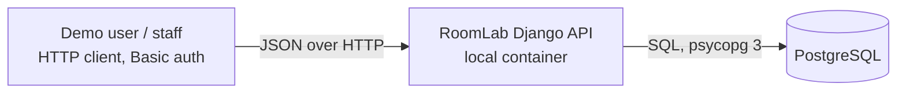

# RoomLab architecture

Local demo only (see `docs/contract.md`). This document covers context, components,
the booking-create sequence and ADR-1.

## 1. Context



No external systems: no signup, email, web UI or outside hosting. Users and rooms come from
the idempotent seed (`seed_demo`).

## 2. Components

| Component | File | Responsibility |
|---|---|---|
| URL routing | `config/urls.py`, `booking/rooms_urls.py`, `booking/flow_urls.py` | `/health/`, `/api/rooms/...`, `/api/bookings/...`, `/api/approvals/...` |
| HTTP boundary | `booking/http.py` | `endpoint(method)`: method check, Basic auth (60 s verified-header cache), `request.user`; `error(code, status)`; `record(row)` serializer |
| Availability search | `booking/rooms.py` | `parse_instant` / `parse_interval` (ISO 8601 with explicit offset, `start < end`), `overlapping()` query, `GET /api/rooms/available/` |
| Booking flow | `booking/flow_urls.py` (+ views, other stages) | create, mine, cancel, approvals |
| Domain model | `booking/models.py` | `Room`, `Booking`, `Booking.Status`, DB check constraints |
| Database | PostgreSQL | source of truth; constraints guarantee integrity under concurrency |

Shared rules used by all components:

* Interval semantics `[start, end)`. Overlap ⇔ `existing.start < new.end AND existing.end > new.start`.
  Adjacent intervals (one ends exactly when the other starts) never conflict.
* Blocking statuses: `ACTIVE`, `PENDING`. `CANCELLED`, `REJECTED` free the slot immediately.
* Timestamps must carry an explicit offset (`Z` or `±HH:MM`); naive values → `400 invalid_input`.
  Comparison is by instant, so `12:00+02:00` equals `10:00Z`. In a query string `+` must be
  sent as `%2B` (a raw `+` decodes to a space and is rejected, not guessed).

### Availability query

```sql
SELECT id, name, capacity FROM booking_room
WHERE id NOT IN (SELECT room_id FROM booking_booking
                 WHERE status IN ('ACTIVE','PENDING') AND start < :end AND "end" > :start)
ORDER BY id;
```

One round trip; the result is a snapshot and is advisory — a room shown as free can be taken
before the client books it. Correctness of booking is enforced at create time (below).

## 3. Create sequence (`POST /api/bookings/`)

```mermaid
sequenceDiagram
    participant C as Client
    participant E as http.endpoint
    participant V as create view
    participant P as rooms.parse_interval
    participant DB as PostgreSQL
    C->>E: POST {room_id,start,end} + Basic auth
    E->>E: method == POST, verify Basic (cache 60 s)
    alt not authenticated
        E-->>C: 401 unauthenticated
    end
    E->>V: request.user set
    V->>P: start, end
    alt missing / bad / naive / start >= end
        V-->>C: 400 invalid_input
    end
    V->>DB: SELECT room
    alt room missing
        V-->>C: 404 not_found
    end
    V->>DB: BEGIN; INSERT booking (status ACTIVE, or PENDING when capacity > 100 in v2)
    alt exclusion constraint violated (overlapping ACTIVE/PENDING in same room)
        DB-->>V: IntegrityError (exclusion_violation)
        V->>DB: ROLLBACK
        V-->>C: 409 slot_conflict
    else ok
        DB-->>V: row
        V->>DB: COMMIT
        V-->>C: 201 {id,room_id,start,end,status}
    end
```

An optional app-level overlap pre-check (same `overlapping()` predicate) may run before the
INSERT for a cheaper common-case 409, but it is never the guarantee — see ADR-1.

## 4. ADR-1: app-only pre-check vs. database exclusion constraint

**Status:** accepted. **Context:** two clients can request the same room and overlapping
time at the same moment; the contract requires that exactly one wins (`201`/`409`) on real
PostgreSQL (`qa/test_contract.py::ConcurrentReservation`).

### Options

**A. App-only pre-check.** `SELECT ... overlapping()`; if empty, `INSERT`.

* + Simple, database-agnostic, easy to unit-test, clear error mapping.
* − Check-then-act race: under `READ COMMITTED` both transactions see no conflict and both
  insert. Fixing it in the app requires extra locking (`SELECT ... FOR UPDATE` on the room
  row, advisory locks or `SERIALIZABLE` with retries) which every write path — create,
  approve, any future admin/import script — must remember to use.
* − Any path that bypasses the view (shell, migration, bulk load) can store overlaps.

**B. Database exclusion constraint** (PostgreSQL `btree_gist`):

```sql
EXCLUDE USING gist (room_id WITH =, tstzrange(start, "end", '[)') WITH &&)
WHERE (status IN ('ACTIVE','PENDING'))
```

(Django: `django.contrib.postgres.constraints.ExclusionConstraint` added to `Booking.Meta.constraints`
next to the existing check constraints, with a `BtreeGistExtension` migration.)

* + Atomic: the second concurrent INSERT blocks on the first and then fails with an
  exclusion violation; no race window, no explicit locks.
* + Holds for every writer, including future ones; `[)` range makes adjacency legal by
  definition, matching the contract; partial `WHERE` means cancelled/rejected rows do not block
  and cancellation frees the slot immediately.
* + GiST index also speeds up the availability overlap query.
* − PostgreSQL-specific (acceptable: the contract mandates PostgreSQL); needs the
  `btree_gist` extension; constraint errors must be mapped to `409 slot_conflict`
  (catch `IntegrityError` inside `transaction.atomic()`).
* Note: approve PENDING→ACTIVE stays inside the blocking set, so it can never conflict; any
  future transition back into a blocking status is also checked by the constraint.

### Decision

Use **B** as the integrity guarantee. Keep the shared `overlapping()` predicate in
`booking/rooms.py` for search and, optionally, as a fast pre-check that only improves the
error path. The availability endpoint stays read-only and advisory.

### Consequences

* Search and create use the same interval rule, so "shown free" and "bookable" agree except
  for genuine races, which the constraint resolves.
* The constraint and its migration belong to the create stage (A2); A1 adds only the shared
  parser/predicate and the read endpoint.
